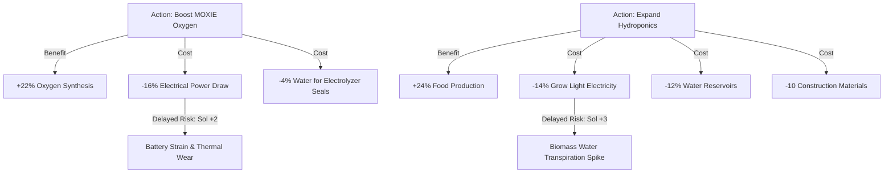

# MARSBOUND: Survive the Red Planet 🪐

> **"Every choice has a cost. Every resource matters."**  
> *THINK LIKE AN ASTRONAUT. DECIDE LIKE AN ENGINEER. SURVIVE LIKE A PIONEER.*

[](https://www.spaceappschallenge.org/)
[](https://react.dev/)
[](https://www.typescriptlang.org/)
[](https://tailwindcss.com/)
[](https://vitest.dev/)
[](https://opensource.org/licenses/MIT)

---

## 🌟 Project Overview

**MARSBOUND: Survive the Red Planet** is a cinematic, browser-based educational survival strategy game engineered for a NASA-themed hackathon and designed specifically for **young explorers aged 7–12**.

In MARSBOUND, the player assumes the mantle of Expedition Commander of **Chryse Planitia Outpost**, overseeing a crew of four brave astronauts through a **30-Martian-day (Sol) campaign**. To survive, the player must balance life support, energy generation, agricultural crops, water recycling, structural radiation shielding, and NASA science experiments while navigating extreme space weather and equipment wear.

Unlike traditional survival games with decorative progress bars or arbitrary penalty meters, MARSBOUND is driven by a deterministic, interconnected **Resource Trade-Off Engine** and a **Delayed Consequence Queue**, grounded in authentic NASA open data.

---

## 🚀 Problem Statement

Space exploration is frequently portrayed in popular culture as either fantasy-like action or intimidating, dry equations. Young learners rarely get hands-on experience with the fundamental principle of aerospace systems engineering:

> **"Systems in space are closed loops: saving one resource invariably puts another at risk."**

When resources run short on Mars, there is no resupply rocket arriving this afternoon. Decisions made on Sol 2 might not reveal their repercussions until Sol 6. Without an interactive, safe sandbox that makes these compromises tangible, children cannot build intuitive systems-thinking skills.

---

## 💡 Proposed Solution

MARSBOUND translates complex NASA aerospace life support and interplanetary physics into an intuitive, visually stunning mission-control simulator:

1. **Deterministic Resource Trade-Off Engine**: Every single action connects two or more systems. Increasing oxygen draws battery power; boosting crop growth consumes water and electricity; saving energy dims habitat lighting and cools living quarters.
2. **Interactive Decision Preview**: Before committing any command, players see an exact, mathematical preview of current values, deltas, and projected values with color-coded indicators. The preview and the actual commit share 100% of their calculation logic.
3. **Delayed Consequence Engine**: Decisions create delayed effects that enter a transparent countdown queue ("Future Risks"), allowing players to see upcoming hazards in advance and deploy counter-measures.
4. **"What If I Chose Differently?" (Signature Multiverse Comparator)**: At any point, players can fork their mission into an isolated parallel timeline to project and graph how alternative decisions would have altered the next 5 Sols.
5. **Real NASA Open Data Integration**: Live and curated feeds from **NASA DONKI** (Space Weather), **NASA Mars 2020 Perseverance Rover**, **NASA APOD**, and **NASA OSDR** (Open Science Data Repository).

---

## 🎯 Target Audience

- **Primary**: Children and middle-grade students aged **7–12**.
- **Secondary**: STEM educators, science museum attendees, and space enthusiasts.
- **Accessibility Features**:
  - Simplified Reading Mode for younger players (ages 7–9).
  - High Contrast visual mode for low-vision accessibility.
  - Sound effect mute controls.
  - Large touch-friendly controls and responsive layouts for tablets and desktops.
  - Accessible color coding paired with explicit text labels: `HEALTHY` (Green), `WARNING` (Yellow), `DANGER` (Orange), `CRITICAL` (Red).

---

## 🎮 Core Gameplay & Mechanics

### The 4 Primary Resources
| Resource | Primary Uses | Base Sources | Depletion Risk |
|---|---|---|---|
| **Oxygen (O2)** | Crew respiration, module pressurization | Sabatier reactor, MOXIE CO2 electrolysis | Hypoxia; critical health failure if 0% |
| **Power (⚡)** | ECLSS air scrubbers, thermal heaters, LED grow lights | Photovoltaic solar array, battery storage | System brownouts; habitat drops to -60°C |
| **Food (🌱)** | Crew nutrition, stamina, morale | Aeroponic hydroponic greenhouse produce | Caloric malnutrition, fatigue |
| **Water (💧)** | Crew hydration, hygiene, hydroponic misting | ECLSS vacuum distillation, subsurface glacial ice | Severe dehydration, crop failure |

### Secondary Systems
- **Radiation Shielding (0–100%)**: Sintered regolith berms and water jackets protecting against cosmic rays and solar flares.
- **Crew Vitality (0–100%)**: Combined physical health and morale of the four named astronauts:
  1. *Sarah Chen* (Mission Commander & Avionics Engineer)
  2. *Dr. Marcus Vance* (Flight Surgeon & Space Biologist)
  3. *Elena Rostova* (Chief Robotics & Life Support Specialist)
  4. *Leo Kim* (Astrobiologist & Plant Physiologist)
- **Construction Materials (0–100)**: 3D printing feedstocks, basalt aggregate, spare seals, and structural alloys.
- **NASA Science Points**: Research discoveries unlocking educational achievements.
- **Cumulative Radiation Dose (mSv)**: Grounded in real NASA MSL Curiosity RAD measurements (~0.67 mSv/day background).

---

## ⚖️ Resource Trade-Off Engine

There are **zero free actions** in MARSBOUND. Every engineering command requires deliberate compromise:



### Strategic Doctrines (Chosen at Mission Start)
1. **Survival First**: +15% Life support O2 efficiency, +15 starting Materials, +20% health recovery from sleep; science output is 20% slower.
2. **Science First**: +40% bonus Science Points, +25 starting Science, early NASA OSDR analysis; spectrometry draws +2 Power.
3. **Sustainability First**: +20% Water recycling efficiency, +15% faster harvest, 25% slower solar dust accumulation; initial shielding starts at 52%.

---

## ⏳ Delayed Consequence Engine

The **Future Risks** engine simulates realistic space hardware dynamics:

1. **Scheduling**: Committing decisions or experiencing severe weather schedules an entry into `delayedQueue` targeting `currentSol + delaySols`.
2. **Countdown Telemetry**: The UI displays real-time countdown badges ("Triggering in 2 Sols").
3. **Traceability**: Every consequence cites its origin (e.g., "Origin: Energy-Saving Mode deployed on Sol 2").
4. **Resolution**: On Sol advance, due consequences resolve deterministically, logging entries into the Daily Report and updating habitat systems.

---

## 🔮 "What If I Chose Differently?" (Signature Multiverse Comparator)

At the end of any Sol, players can launch the **Multiverse Comparator**:
- Clones the mission state into an isolated sandbox without altering the player's saved game.
- Applies an alternative decision (e.g., "What if I conducted research instead of entering power-saving mode?").
- Simulates and graphs a **5-Sol forward projection** using **Recharts**.
- Displays interactive divergence curves for Oxygen, Power, Food, Water, Crew Health, and Science.

---

## 📡 NASA Data Integration & Scientific Transparency

MARSBOUND upholds strict scientific transparency using three standardized badges:
- `🟢 LIVE NASA DATA`: Telemetry fetched in real-time from `api.nasa.gov`.
- `🔵 ARCHIVED NASA DATA`: Authenticated historical datasets from published NASA research.
- `🟡 EDUCATIONAL SIMULATION`: Physics-grounded mathematical models created for child-friendly gameplay.

| NASA Domain | Endpoint / Source | How MARSBOUND Uses It |
|---|---|---|
| **NASA DONKI** | `https://api.nasa.gov/DONKI/` | Real Coronal Mass Ejection (CME) and solar flare records trigger the signature Solar Storm event. |
| **NASA Mars Rover Photos** | `https://api.nasa.gov/mars-photos/` | Real high-resolution Mastcam-Z, Navcam, and Hazcam photos captured by Perseverance in Jezero Crater. |
| **NASA APOD** | `https://api.nasa.gov/planetary/apod` | Daily Astronomy Picture of the Day discovery cards with verified astronomical explanations. |
| **NASA OSDR** | `https://osdr.nasa.gov/` | Authentic space biology studies (OSD-102 bone density loss, OSD-120 plant microgreens, OSD-379 immunity). |
| **NASA RadLab / MSL RAD** | Curiosity Science Telemetry | Real Martian surface radiation dose rates (0.67 mSv/day) vs Low Earth Orbit ISS rates. |

---

## 🏫 Mars Academy (10 Interactive Lessons & Quizzes)

1. *Why Do Astronauts Need Oxygen?* (MOXIE CO2 electrolysis at 800°C)
2. *Why Is Mars So Cold?* (Distance from Sun & thin atmosphere)
3. *What Is Space Radiation?* (Galactic Cosmic Rays vs Solar Protons)
4. *Why Do Solar Panels Lose Power in Dust?* (Dust storms & electrostatic adhesion)
5. *How Does Hydroponic Farming Work?* (Growing crops without soil)
6. *Why Does Calling Mars Take Time?* (Speed of light & orbital distance)
7. *How Do Astronauts Recycle Water?* (ECLSS vacuum distillation of moisture and urine)
8. *How Can Humans Shield Against Radiation?* (Hydrogen-rich water walls & regolith)
9. *How Does Low Gravity (0.38g) Change Human Bodies?* (Bone mineral loss & muscle atrophy)
10. *Why Is Teamwork Vital on Mars?* (Crew cohesion & psychological wellness)

Each lesson includes child-friendly explanations, fun facts, direct game connections, and an interactive knowledge quiz with instant encouraging feedback!

---

## 🛠️ Technology Stack

- **Framework**: React 18 + Vite 5 + TypeScript 5
- **Styling**: Tailwind CSS 3 (Deep space dark theme, HUD neon accents)
- **Animations**: Framer Motion 11
- **Icons**: Lucide React
- **Data Visualization**: Recharts 2 (Multiverse timeline charts)
- **Audio Synthesizer**: Web Audio API (zero external audio file dependencies)
- **Celebrations**: Canvas-Confetti
- **Testing**: Vitest (13 comprehensive deterministic unit tests)
- **Persistence**: Browser LocalStorage with automatic state sync

---

## 📦 Installation & Local Setup

### Prerequisites
- Node.js v18.0+ or v20.0+ LTS
- npm v9.0+

### Steps
```bash
# 1. Clone the repository
git clone https://github.com/your-username/marsbound.git
cd marsbound

# 2. Install dependencies
npm install

# 3. Configure environment (optional - defaults to NASA DEMO_KEY with resilient offline fallbacks)
cp .env.example .env

# 4. Run the development server
npm run dev

# 5. Open your browser
# Navigate to http://localhost:5173
```

---

## 🧪 Running Unit Tests

MARSBOUND features a complete test suite covering the deterministic resource calculations, requirement checks, consequence queues, and ending evaluations:

```bash
npm test
```

### Production Build
```bash
npm run build
```
Creates an optimized, code-split production bundle in `/dist` with zero linting or type errors.

---

## 📖 How to Play (Commander Field Guide)

1. **Select Strategic Doctrine**: Choose between *Survival First*, *Science First*, or *Sustainability First*.
2. **Review Chryse Dashboard**: Monitor your four primary resource gauges (Oxygen, Power, Food, Water).
3. **Handle Incoming Space Events**: When a space weather CME or dust storm occurs, choose a response that fits your strategic doctrine.
4. **Deploy Outpost Decisions**: Select engineering protocols from the catalog. Preview the exact before/after resource deltas before confirming.
5. **Check Future Risks**: Keep an eye on queued delayed consequences and take counter-actions before they trigger.
6. **Advance the Sol**: Click **Advance to Sol X+1** to cycle production, consumption, and delayed impacts. Read the Mission Debrief to learn the science behind what happened.
7. **Complete 30 Sols**: Keep your astronauts safe and achieve an **A+** mission rating!

---

## 🔬 Scientific Limitations & Disclaimers

1. **Educational Simplification**: Resource percentages (0–100%) and daily consumption rates are simplified representations designed to teach children systems thinking and trade-offs rather than exact kilograms of liquid oxygen.
2. **Solar Weather vs Surface Dose**: A NASA DONKI Coronal Mass Ejection notification does not directly measure Martian surface radiation doses. MARSBOUND uses an educational hazard classification model clearly labeled as simulated.
3. **Zero Paid Dependencies**: The game runs 100% in the client browser with no registration, no backend server, and no paywalls.

---

## 🚀 Future Roadmap

- [ ] **Multi-Habitat Expansion**: Establish secondary outpost domes in Valles Marineris and Utopia Planitia.
- [ ] **Voice Synthesizer**: Text-to-speech for Houston Flight Director radio dispatches.
- [ ] **WebXR Mars Dome Walkthrough**: 3D spatial view of the hydroponic bay and MOXIE oxygen reactors.
- [ ] **Multi-Language Localization**: Spanish, French, and Japanese translations for global classroom reach.

---

## 📜 License

MARSBOUND is released under the **MIT License**. Created with admiration for NASA's open science missions.

---

**MARSBOUND**  
*THINK LIKE AN ASTRONAUT. DECIDE LIKE AN ENGINEER. SURVIVE LIKE A PIONEER.*
